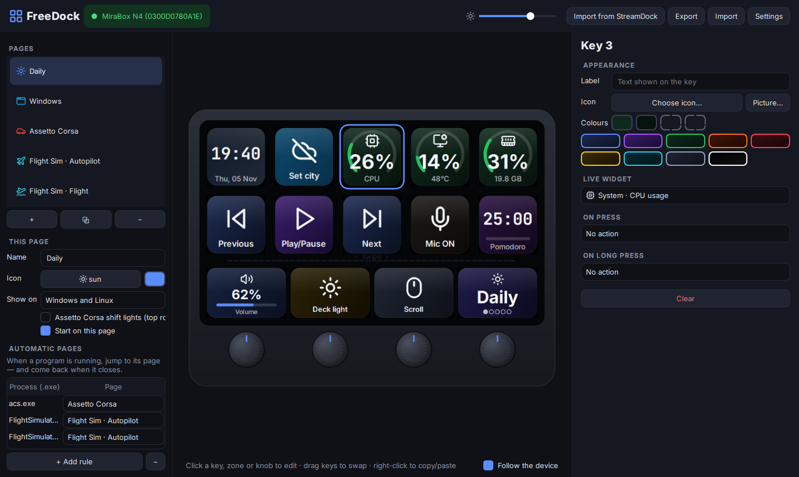
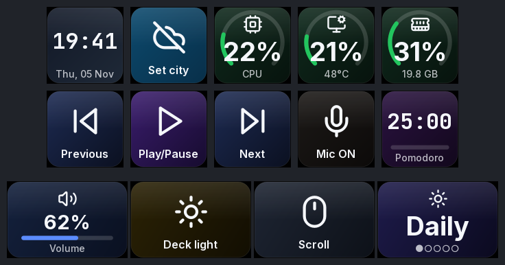
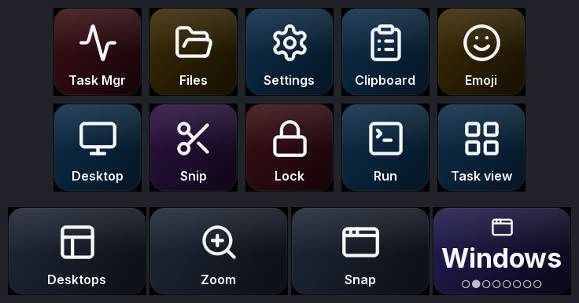
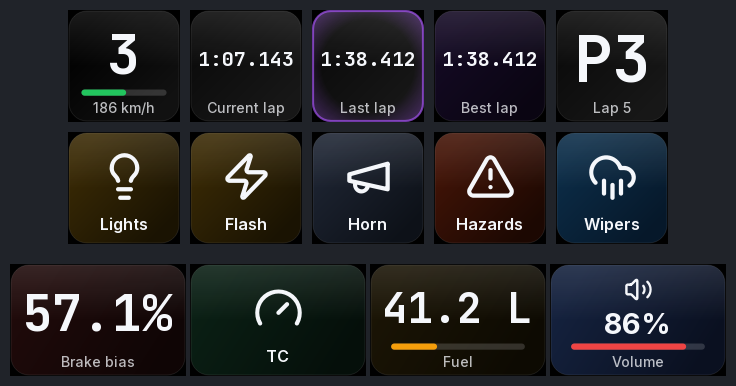
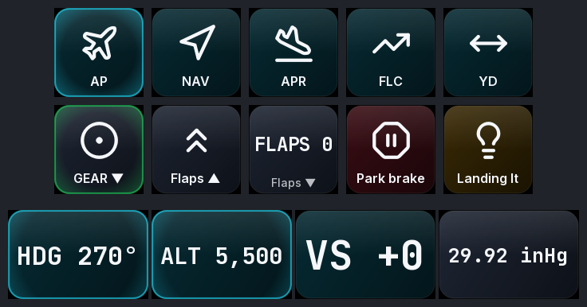
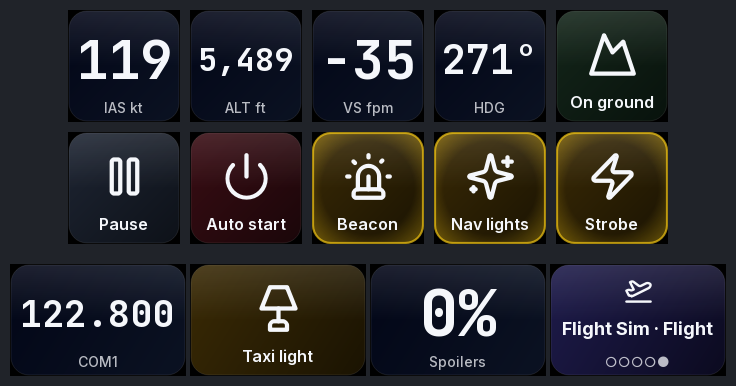

<div align="center">

# FreeDock

**Libera tu MiraBox N4.**
Driver y editor visual de código abierto para el MiraBox N4 StreamDock, en Windows 11 y Linux.
Reemplaza la app del fabricante: sin cuenta, sin nube, sin telemetría.

[](LICENSE)


[English](README.md) · [Português](README.pt-BR.md) · **Español**



</div>

---

## Por qué

El N4 es un gran hardware con una app frustrante: solo funciona en Windows y macOS, trae un
perfil por defecto en chino, mete los plugins dentro de un navegador y necesita unos 30 procesos
corriendo solo para mostrar iconos. FreeDock habla con el deck directamente por USB HID. Es una
sola app pequeña, da el mismo control en Linux y añade lo que la app oficial nunca tuvo.

## Funciones

| | |
|---|---|
| 🖥️ **Editor visual en vivo** | Una réplica clicable del N4 que refleja las pantallas reales cuadro a cuadro. Arrastra teclas para intercambiarlas, usa el clic derecho para copiar y pegar, elige entre más de 1.500 iconos o usa tus propias imágenes. |
| ✨ **Animaciones** | Efecto de tecla hundida y onda al soltar, transición de página que recorre el deck, animación de arranque y salvapantallas "aurora" con reloj. |
| 📊 **Widgets en vivo** | Reloj, fecha, clima, CPU/GPU/RAM, red, volumen, estado del micrófono, Pomodoro, cronómetro, estado de OBS. |
| 🏎️ **Assetto Corsa** | Marcha, vueltas (morado = mejor vuelta), posición, combustible, reparto de freno y temperatura de neumáticos, desde la memoria compartida. **Luces de cambio** en la fila superior. Las teclas disparan *tus propios* controles, leídos de `controls.ini`. |
| ✈️ **Flight Simulator 2020/2024** | Página de piloto automático: las perillas ajustan HDG, ALT, VS y BARO, y la barra muestra los valores en vivo. Tren, flaps, luces y frenos se iluminan según el simulador. Usa SimConnect directamente, sin SDK ni complementos de pago. |
| 🧭 **Nunca te pierdes** | En cualquier página, **mantén pulsada una tecla 1,2 s** para abrir el menú de páginas. Toca la página que quieras, o gira cualquier perilla y púlsala para elegir. **Deslizar la barra** siempre cambia de página, y el nombre de la página aparece en la barra para que sepas dónde estás. |
| 🔁 **Páginas automáticas** | Abres Assetto Corsa o MSFS y el deck salta a su página. Al cerrarlo, vuelve. Funciona con cualquier `.exe`. |
| ⌨️ **Acciones** | Atajos (se graban pulsándolos), escribir texto, abrir webs o archivos, abrir programas, comandos, multimedia, volumen, micrófono, desplazamiento, multiacciones con pausas, webhooks, OBS. |
| 🎛️ **Todos los controles** | 10 teclas (toque y mantener), 4 zonas táctiles, 4 perillas (izquierda, derecha, pulsar) y el deslizamiento en la barra. Cada zona de la barra funciona como la pantalla de la perilla de abajo. |
| 📥 **Importación** | Trae tus páginas de la app oficial StreamDock. Los perfiles son JSON legible y fácil de compartir. |
| 🌍 **3 idiomas** | English, Português (Brasil), Español. |
| 🐧 **Linux de verdad** | Regla udev, teclado virtual uinput (X11 *y* Wayland), volumen con PipeWire, servicio systemd de usuario y PKGBUILD para Arch/CachyOS. |

## Las páginas que trae

| Día a día | Windows | Assetto Corsa |
|---|---|---|
|  |  |  |

| Flight Sim · Piloto automático | Flight Sim · Vuelo |
|---|---|
|  |  |

<sub>Vistas previas generadas con `freedock preview --demo`, que alimenta datos simulados de los juegos. La app muestra los textos en tu idioma.</sub>

## Instalación

> Cierra antes la app oficial StreamDock (icono de la bandeja → Salir). Dos programas no pueden controlar las pantallas a la vez.

### Windows 10 / 11

```powershell
irm https://raw.githubusercontent.com/agentkyo/freedock/main/packaging/windows/install.ps1 | iex
```

Se instala en `%LOCALAPPDATA%\FreeDock` y se ejecuta con el `pythonw.exe` firmado de python.org,
así que funciona incluso con **Smart App Control** activado. Activa *Ajustes → Iniciar con el
equipo* para dejarlo en la bandeja.

**`FreeDock.exe` independiente** (sin Python en el PC de destino): ejecuta
`python packaging\windowsuild_exe.py` en un clon con `pip install pyinstaller`. El exe no está
firmado, así que Windows lo bloquea mientras Smart App Control esté activado.

### Linux (cualquier distro)

```bash
git clone https://github.com/agentkyo/freedock && cd freedock
./packaging/linux/install.sh
```

El instalador añade la regla udev (pide `sudo` una vez), un acceso en el menú y, si quieres, el
inicio automático. Después, desconecta y vuelve a conectar el N4.

### Arch / CachyOS / EndeavourOS

```bash
cd packaging/arch && makepkg -si
```

### Desde el código fuente (desarrolladores)

```bash
pip install -e ".[dev]"
freedock            # editor
pytest              # pruebas
```

## Línea de comandos

```text
freedock                       abre el editor (queda en la bandeja)
freedock run                   sin ventana, por ejemplo como servicio
freedock list                  lista los N4 conectados
freedock events                muestra cada tecla / perilla / toque recibido
freedock preview --out dir     renderiza todas las páginas en PNG
freedock import-streamdock     importa páginas de la app oficial
freedock reset-profile         hace copia de seguridad y restaura las páginas por defecto
--demo                         datos simulados de Assetto Corsa / MSFS (en cualquier comando)
```

El perfil está en `%APPDATA%\FreeDock\profile.json` o en `~/.config/freedock/profile.json`.

## Notas sobre los juegos

**Assetto Corsa.** La telemetría no necesita nada extra. Las teclas usan tus controles de
`Documentos/Assetto Corsa/cfg/controls.ini`, incluidos los extras de Content Manager y CSP (luces
de emergencia, limpiaparabrisas, mapa motor). Las ayudas propias de AC (ABS, TC…) llevan Ctrl
implícito, y FreeDock se encarga de ello. Si un comando solo está en un botón del volante, el
editor muestra *"sin tecla"*. Asígnale una tecla libre en los controles de AC y el deck la usará.

**Flight Simulator 2020/2024.** FreeDock carga `SimConnect.dll` desde el SDK de MSFS, desde la
carpeta del plugin MSFS de Logitech o desde una ruta que definas en *Ajustes → Integraciones*.
Cualquier SimVar y cualquier evento K: puede ir en cualquier tecla, perilla o zona.

## Problemas comunes

- **El N4 se conecta y desconecta sin parar (el sonido de Windows cada pocos segundos).** Es
  alimentación o cable. El enlace USB 3 del N4 falla, y el modo USB 2 no alcanza para alimentar
  las pantallas y el hub interno. Usa el cable original, conectado directamente a un puerto trasero
  de la placa base, o alimenta el N4 por su entrada de energía.
- **Las pantallas muestran el logo de fábrica.** Otro programa, normalmente la app oficial, tiene
  el deck tomado. Ciérralo.
- **Linux: "No MiraBox N4 found".** Falta la regla udev. Reconecta el N4 después de instalarla.
- **Linux: los atajos no hacen nada.** `/dev/uinput` también necesita la regla (`sudo modprobe uinput`).

## Cómo funciona

El N4 habla un protocolo HID sencillo, el "CRT": reportes de 1024 bytes, imágenes JPEG giradas
180° y un latido de conexión. Está documentado por completo en
**[docs/PROTOCOL.md](docs/PROTOCOL.md)** (en inglés). El motor dibuja cada tecla con QPainter a
30 fps y solo reenvía una tecla cuando su imagen cambia de verdad.

## Hoja de ruta

- [ ] Teclas con GIF animado
- [ ] Fondo de pantalla completa (`BGPIC`) en el N4
- [ ] Carátula de lo que suena (sesión multimedia de Windows / MPRIS)
- [ ] Entidades de Home Assistant
- [ ] Otros decks de la misma familia (N3, N4 Pro, Ajazz AKP05)

## Contribuir

Issues y PRs son bienvenidos, sobre todo pruebas en otras variantes del N4: ejecuta `freedock
events` y pega la salida. Las traducciones están en `tools/gen_locales.py`.

## Licencia

[MIT](LICENSE) © agentkyo. Iconos: Lucide (ISC). Fuentes: Inter y JetBrains Mono (OFL). Ver [THIRD_PARTY.md](THIRD_PARTY.md).
FreeDock no está afiliado a MiraBox / HotSpot.
