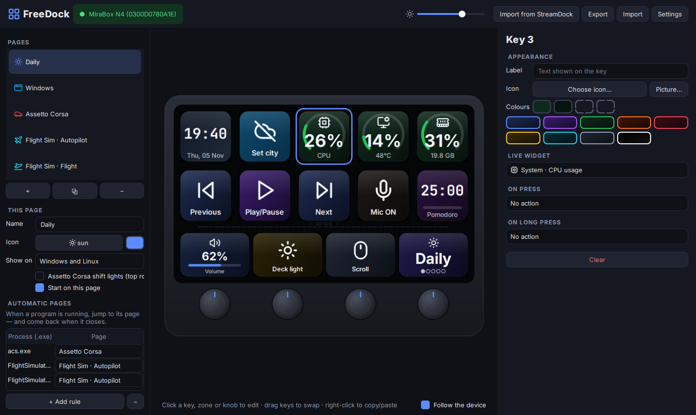
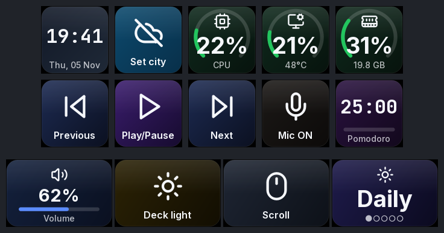
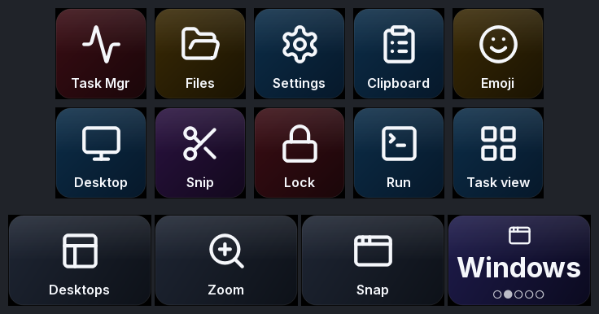
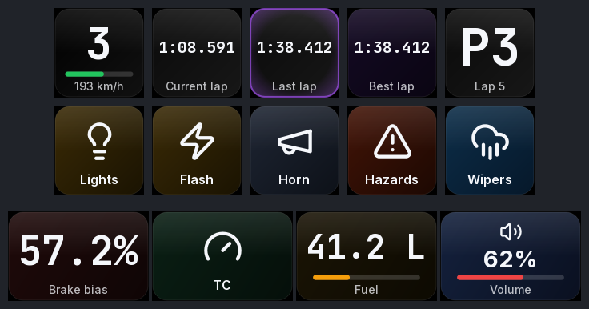
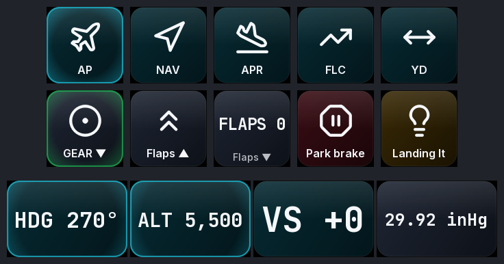
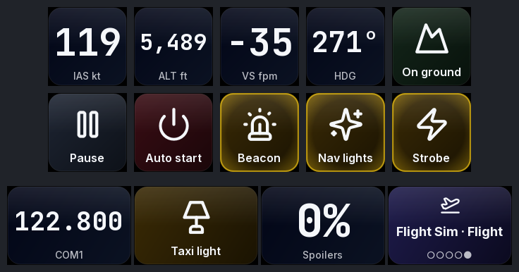

<div align="center">

# FreeDock

**Set your MiraBox N4 free.**
An open-source driver and visual editor for the MiraBox N4 StreamDock, for Windows 11 and Linux.
It replaces the vendor app: no account, no cloud, no telemetry.

[](LICENSE)


**English** · [Português](README.pt-BR.md) · [Español](README.es.md)



</div>

---

## Why

The N4 is great hardware with a frustrating app: it is Windows/macOS only, ships a Chinese
default profile, nests plugins inside a browser engine, and needs about 30 processes running just
to show icons. FreeDock talks to the deck directly over USB HID. It is one small app, gives you
the same control on Linux, and adds things the vendor app never had.

## Features

| | |
|---|---|
| 🖥️ **Live visual editor** | A clickable replica of the N4 that mirrors the real screens frame by frame. Drag keys to swap them, right-click to copy and paste, pick from 1,500+ icons, or use your own pictures. |
| ✨ **Animations** | Press-down and ripple feedback, a page transition that sweeps across the deck, a boot animation, and an aurora screensaver with a clock. |
| 📊 **Live widgets** | Clock, date, weather, CPU/GPU/RAM gauges, network, volume, mic state, Pomodoro, stopwatch, OBS status. |
| 🏎️ **Assetto Corsa** | Gear, laps (purple = personal best), position, fuel, brake bias and tyre temps from shared memory. **Shift lights** run across the top row. Keys fire *your own* bindings, read from `controls.ini`. |
| ✈️ **Flight Simulator 2020/2024** | An autopilot page: knobs set HDG, ALT, VS and BARO, and the strip shows the values live. Gear, flaps, lights and brakes light up from the sim. Uses SimConnect directly, no SDK or paid add-on. |
| 🔁 **Automatic pages** | Open Assetto Corsa or MSFS and the deck switches to its page, then switches back when you quit. Works with any `.exe`. |
| ⌨️ **Actions** | Hotkeys (recorded by pressing them), type text, open URLs or files, launch apps, commands, media, volume, mic, scroll, multi-actions with delays, webhooks, OBS. |
| 🎛️ **Every control** | 10 keys (tap and long-press), 4 touch zones, 4 knobs (left, right, push) and the strip swipe. Each strip zone acts as the display of the knob below it. |
| 📥 **Import** | Brings your pages over from the official StreamDock app. Profiles are plain JSON you can share. |
| 🌍 **3 languages** | English, Português (Brasil), Español. |
| 🐧 **Linux first-class** | udev rule, uinput virtual keyboard (X11 *and* Wayland), PipeWire volume, a systemd user service and a PKGBUILD for Arch/CachyOS. |

## The pages it ships with

| Daily | Windows | Assetto Corsa |
|---|---|---|
|  |  |  |

| Flight Sim · Autopilot | Flight Sim · Flight |
|---|---|
|  |  |

<sub>These previews were rendered with `freedock preview --demo`, which feeds simulated game data.</sub>

## Install

> Close the official StreamDock app first (tray icon → Exit). Two programs cannot drive the screens at the same time.

### Windows 10 / 11

```powershell
irm https://raw.githubusercontent.com/agentkyo/freedock/main/packaging/windows/install.ps1 | iex
```

It installs into `%LOCALAPPDATA%\FreeDock` and runs through the signed `pythonw.exe` from
python.org, so it also works with **Smart App Control** enabled. Turn on *Settings → Start with
the computer* to keep it in the tray.

### Linux (any distro)

```bash
git clone https://github.com/agentkyo/freedock && cd freedock
./packaging/linux/install.sh
```

The installer adds the udev rule (it asks for `sudo` once), a menu entry and optional autostart.
Unplug and re-plug the N4 afterwards.

### Arch / CachyOS / EndeavourOS

```bash
cd packaging/arch && makepkg -si
```

### From source (developers)

```bash
pip install -e ".[dev]"
freedock            # editor
pytest              # tests
```

## Command line

```text
freedock                       open the editor (tray app)
freedock run                   headless, e.g. as a service
freedock list                  list connected N4s
freedock events                print every key / knob / touch event
freedock preview --out dir     render all pages to PNG
freedock import-streamdock     import pages from the vendor app
freedock reset-profile         back up and restore the default pages
--demo                         fake Assetto Corsa / MSFS data (any command)
```

Your profile lives in `%APPDATA%\FreeDock\profile.json` or `~/.config/freedock/profile.json`.

## Game notes

**Assetto Corsa.** Telemetry needs nothing extra. Keys use your bindings from
`Documents/Assetto Corsa/cfg/controls.ini`, including Content Manager and CSP extras (hazards,
wipers, engine map). AC's own assists (ABS, TC…) imply Ctrl, and FreeDock handles that. If a
command is mapped only to a wheel button, the editor shows *"no keyboard key"*. Give it a free key
in AC's controls and the deck will use it.

**Flight Simulator 2020/2024.** FreeDock loads `SimConnect.dll` from the MSFS SDK, from the
Logitech MSFS plugin folder, or from a path you set in *Settings → Integrations*. Any SimVar and
any K-event can go on any key, knob or zone.

## Troubleshooting

- **The N4 keeps connecting and disconnecting (the Windows sound every few seconds).** This is
  power or cabling. The N4's USB 3 link is failing and the USB 2 fallback cannot feed the
  screens and the built-in hub. Use the original cable, plugged straight into a rear motherboard
  port, or power the N4 through its own power input.
- **The screens show the factory logo.** Another program, usually the vendor app, holds the deck.
  Close it.
- **Linux: "No MiraBox N4 found".** The udev rule is missing. Re-plug after installing it.
- **Linux: hotkeys do nothing.** `/dev/uinput` needs the rule as well (`sudo modprobe uinput`).

## How it works

The N4 speaks a small "CRT" HID protocol: 1024-byte reports, JPEG key images rotated 180°, and a
heartbeat. It is fully documented in **[docs/PROTOCOL.md](docs/PROTOCOL.md)**. The engine renders
every key with QPainter at 30 fps, and it only re-sends a key when its picture actually changes.

## Roadmap

- [ ] Animated GIF keys
- [ ] Full-panel backgrounds (`BGPIC`) on the N4
- [ ] Now-playing cover art (Windows media session / MPRIS)
- [ ] Home Assistant entities
- [ ] More decks of the same family (N3, N4 Pro, Ajazz AKP05)

## Contributing

Issues and PRs are welcome, especially tests on other N4 variants: run `freedock events` and
paste the output. Translations live in `tools/gen_locales.py`.

## License

[MIT](LICENSE) © agentkyo. Icons: Lucide (ISC). Fonts: Inter and JetBrains Mono (OFL). See [THIRD_PARTY.md](THIRD_PARTY.md).
FreeDock is not affiliated with MiraBox / HotSpot.
