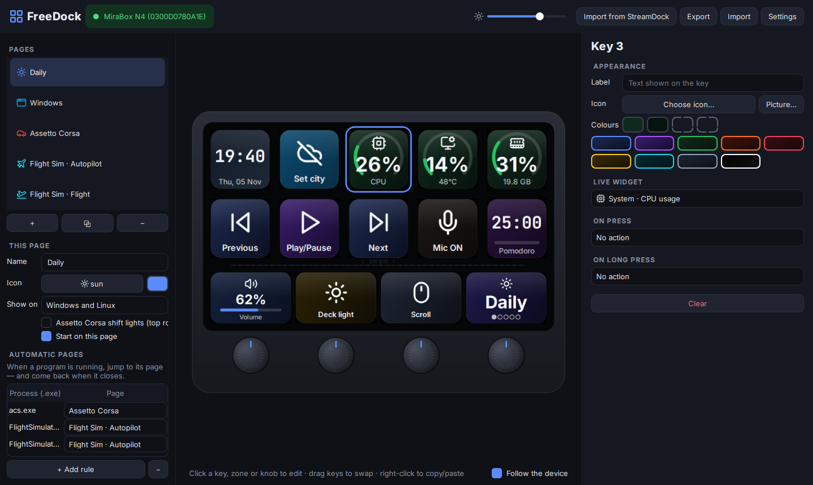
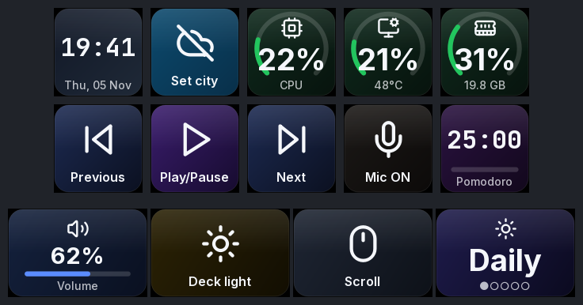
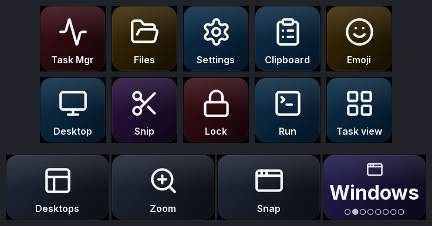
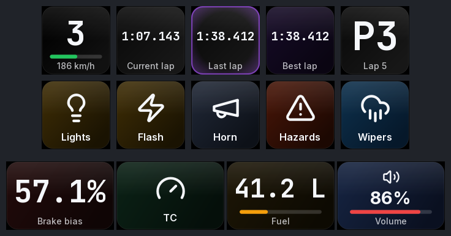
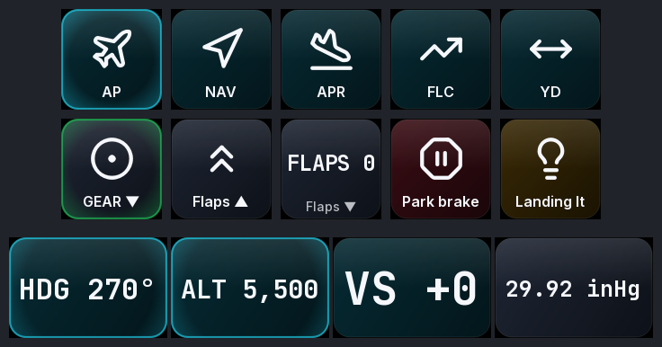
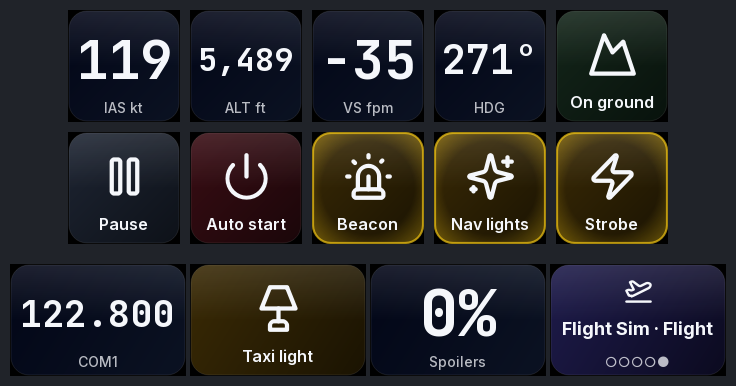

<div align="center">

# FreeDock

**Liberte o seu MiraBox N4.**
Driver e editor visual de código aberto para o MiraBox N4 StreamDock, no Windows 11 e no Linux.
Substitui o app do fabricante: sem conta, sem nuvem, sem telemetria.

[](LICENSE)


[English](README.md) · **Português** · [Español](README.es.md)



</div>

---

## Por quê

O N4 é um ótimo hardware com um app frustrante: roda só em Windows e macOS, vem com um perfil
padrão em chinês, enfia os plugins dentro de um navegador e precisa de uns 30 processos rodando só
para mostrar ícones. O FreeDock conversa com o deck direto por USB HID. É um app só, pequeno, que
dá o mesmo controle no Linux e traz o que o app oficial nunca teve.

## Recursos

| | |
|---|---|
| 🖥️ **Editor visual ao vivo** | Uma réplica clicável do N4 que espelha as telas reais quadro a quadro. Arraste teclas para trocar de lugar, use o clique direito para copiar e colar, escolha entre mais de 1.500 ícones ou use suas próprias imagens. |
| ✨ **Animações** | Efeito de tecla afundando e ondulação ao soltar, transição de página que varre o deck, animação de inicialização e protetor de tela "aurora" com relógio. |
| 📊 **Widgets ao vivo** | Relógio, data, clima, CPU/GPU/RAM, rede, volume, estado do microfone, Pomodoro, cronômetro, status do OBS. |
| 🏎️ **Assetto Corsa** | Marcha, voltas (roxo = melhor volta), posição, combustível, balanço de freio e temperatura dos pneus, direto da memória compartilhada. **Shift lights** na fileira de cima. As teclas disparam os *seus* binds, lidos do `controls.ini`. |
| ✈️ **Flight Simulator 2020/2024** | Página de piloto automático: os knobs ajustam HDG, ALT, VS e BARO, e a faixa mostra os valores ao vivo. Trem, flaps, luzes e freios acendem conforme o simulador. Usa o SimConnect direto, sem SDK nem add-on pago. |
| 🧭 **Você nunca se perde** | Em qualquer página, **segure uma tecla por 1,2 s** para abrir o menu de páginas. Toque na página que quer, ou gire qualquer knob e aperte para escolher. **Deslizar na faixa** sempre troca de página, e o nome da página aparece na faixa para você saber onde está. |
| 🔁 **Páginas automáticas** | Abriu o Assetto Corsa ou o MSFS, o deck pula para a página dele. Fechou, ele volta. Funciona com qualquer `.exe`. |
| ⌨️ **Ações** | Atalhos (gravados apertando as teclas), digitar texto, abrir sites ou arquivos, abrir programas, comandos, mídia, volume, microfone, rolagem, multiações com intervalo, webhooks, OBS. |
| 🎛️ **Todos os controles** | 10 teclas (toque e segurar), 4 zonas touch, 4 knobs (esquerda, direita, apertar) e o deslizar na faixa. Cada zona da faixa funciona como o display do knob logo abaixo. |
| 📥 **Importação** | Traz suas páginas do app oficial StreamDock. Os perfis são JSON legível e fácil de compartilhar. |
| 🌍 **3 idiomas** | English, Português (Brasil), Español. |
| 🐧 **Linux de verdade** | Regra udev, teclado virtual uinput (X11 *e* Wayland), volume pelo PipeWire, serviço systemd de usuário e PKGBUILD para Arch/CachyOS. |

## As páginas que já vêm prontas

| Dia a dia | Windows | Assetto Corsa |
|---|---|---|
|  |  |  |

| Flight Sim · Piloto automático | Flight Sim · Voo |
|---|---|
|  |  |

<sub>Prévias geradas com `freedock preview --demo`, que alimenta dados simulados dos jogos. O app mostra os textos no seu idioma.</sub>

## Instalação

> Feche antes o app oficial StreamDock (ícone da bandeja → Sair). Dois programas não conseguem controlar as telas ao mesmo tempo.

### Windows 10 / 11

```powershell
irm https://raw.githubusercontent.com/agentkyo/freedock/main/packaging/windows/install.ps1 | iex
```

Instala em `%LOCALAPPDATA%\FreeDock` e roda pelo `pythonw.exe` assinado do python.org, então
funciona até com o **Controle Inteligente de Aplicativos** (Smart App Control) ligado. Ative
*Configurações → Iniciar com o computador* para deixá-lo na bandeja.

### Linux (qualquer distro)

```bash
git clone https://github.com/agentkyo/freedock && cd freedock
./packaging/linux/install.sh
```

O instalador coloca a regra udev (pede `sudo` uma vez), um atalho no menu e, se você quiser, o
início automático. Depois, desconecte e reconecte o N4.

### Arch / CachyOS / EndeavourOS

```bash
cd packaging/arch && makepkg -si
```

### Pelo código-fonte (desenvolvedores)

```bash
pip install -e ".[dev]"
freedock            # editor
pytest              # testes
```

## Linha de comando

```text
freedock                       abre o editor (fica na bandeja)
freedock run                   sem janela, por exemplo como serviço
freedock list                  lista os N4 conectados
freedock events                mostra cada tecla / knob / toque recebido
freedock preview --out pasta   renderiza todas as páginas em PNG
freedock import-streamdock     importa páginas do app oficial
freedock reset-profile         faz backup e restaura as páginas padrão
--demo                         dados simulados de Assetto Corsa / MSFS (em qualquer comando)
```

O perfil fica em `%APPDATA%\FreeDock\profile.json` ou em `~/.config/freedock/profile.json`.

## Notas sobre os jogos

**Assetto Corsa.** A telemetria não precisa de nada extra. As teclas usam os seus binds de
`Documentos/Assetto Corsa/cfg/controls.ini`, incluindo os extras do Content Manager e do CSP
(pisca-alerta, limpador, mapa de motor). Os auxílios do próprio AC (ABS, TC…) levam Ctrl implícito,
e o FreeDock cuida disso. Se um comando estiver só num botão do volante, o editor mostra *"sem
tecla no teclado"*. Dê a ele uma tecla livre nos controles do AC e o deck passa a usá-la.

**Flight Simulator 2020/2024.** O FreeDock carrega o `SimConnect.dll` do SDK do MSFS, da pasta do
plugin MSFS da Logitech ou de um caminho que você define em *Configurações → Integrações*.
Qualquer SimVar e qualquer evento K: pode ir em qualquer tecla, knob ou zona.

## Problemas comuns

- **O N4 fica conectando e desconectando (aquele som do Windows a cada poucos segundos).** É
  energia ou cabo. O link USB 3 do N4 falha, e o modo USB 2 não aguenta alimentar as telas e o hub
  interno. Use o cabo original, ligado direto numa porta traseira da placa-mãe, ou alimente o N4
  pela entrada de energia dele.
- **As telas mostram o logo de fábrica.** Outro programa, geralmente o app oficial, está segurando
  o deck. Feche-o.
- **Linux: "No MiraBox N4 found".** Falta a regra udev. Reconecte o N4 depois de instalá-la.
- **Linux: os atalhos não fazem nada.** O `/dev/uinput` também precisa da regra (`sudo modprobe uinput`).

## Como funciona

O N4 fala um protocolo HID simples, o "CRT": relatórios de 1024 bytes, imagens JPEG giradas 180° e
um heartbeat. Está todo documentado em **[docs/PROTOCOL.md](docs/PROTOCOL.md)** (em inglês). O
engine desenha cada tecla com QPainter a 30 fps e só reenvia uma tecla quando a imagem dela muda de
verdade.

## Próximos passos

- [ ] Teclas com GIF animado
- [ ] Fundo de tela inteira (`BGPIC`) no N4
- [ ] Capa do que está tocando (sessão de mídia do Windows / MPRIS)
- [ ] Entidades do Home Assistant
- [ ] Outros decks da mesma família (N3, N4 Pro, Ajazz AKP05)

## Contribuindo

Issues e PRs são bem-vindos, principalmente testes em outras variantes do N4: rode `freedock
events` e cole a saída. As traduções ficam em `tools/gen_locales.py`.

## Licença

[MIT](LICENSE) © agentkyo. Ícones: Lucide (ISC). Fontes: Inter e JetBrains Mono (OFL). Veja [THIRD_PARTY.md](THIRD_PARTY.md).
O FreeDock não tem vínculo com a MiraBox / HotSpot.
